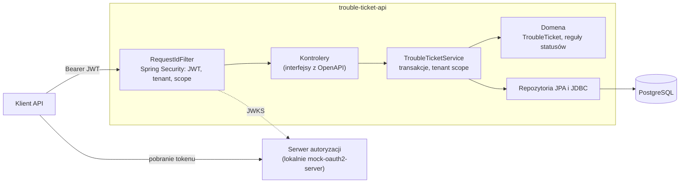

# Trouble Ticket API

Implementacja kontraktu [`api/trouble-ticket-api.yaml`](api/trouble-ticket-api.yaml) (minimalny, design-first profil
TMF621 Trouble Ticket) w Spring Boot 4.1 i Javie 21. Usługa udostępnia dokładnie pięć operacji kontraktu: utworzenie
zgłoszenia (idempotentne po `externalId`), listę i pobranie zgłoszenia, zamknięcie przez klienta API oraz dodanie
notatki. Tenant scope wynika wyłącznie z tokenu JWT.

- [Zgodność z wymaganiami zadania](#zgodność-z-wymaganiami-zadania)
- [Uruchomienie](#uruchomienie) i [weryfikacja w 5 minut](#weryfikacja-w-5-minut)
- [Testy](#testy)
- [Architektura](#architektura)
- [Decyzje techniczne](#decyzje-techniczne)
- [Założenia i interpretacja kontraktu](#założenia-i-interpretacja-kontraktu)
- [Bezpieczeństwo](#bezpieczeństwo)
- [Uproszczenia, ryzyka i kompromisy](#uproszczenia-i-świadome-ograniczenia-zakresu)
- [Co dalej przed produkcją](#co-dalej-przed-produkcją)

## Zgodność z wymaganiami zadania

| Wymaganie | Gdzie |
|---|---|
| Implementacja zgodna ze specyfikacją OpenAPI, Spring Boot i Java 21 | Kontrakt w `api/` bez zmian; interfejsy i DTO są z niego generowane przy każdej kompilacji; kod w `src/main/java` |
| Testy | `src/test/java`: jednostkowe, warstwy web, integracyjne na PostgreSQL i kontraktowe ([Testy](#testy)) |
| Docker Compose z aplikacją i PostgreSQL | `compose.yaml`, `Dockerfile` |
| Instrukcja uruchomienia | [Uruchomienie](#uruchomienie) |
| Założenia i decyzje techniczne | [Decyzje techniczne](#decyzje-techniczne), [Założenia](#założenia-i-interpretacja-kontraktu) |
| Uproszczenia, ryzyka, kompromisy | [Uproszczenia](#uproszczenia-i-świadome-ograniczenia-zakresu), [Ryzyka](#ryzyka), [Kompromisy](#kompromisy) |
| Repozytorium z historią commitów i tagiem | `git log --graph`, tag `v1.0.0` ([Repozytorium](#repozytorium)) |

## Uruchomienie

Potrzebny jest tylko Docker z Compose v2:

```bash
docker compose up --build --wait
```

| Kontener | Adres | Rola |
|---|---|---|
| `app` | http://localhost:8080/api/v1 | API; health (liveness, readiness) na porcie 8081, dostępny tylko w sieci Compose |
| `postgres` | niepublikowany | PostgreSQL 18.6, dane w wolumenie `pgdata` |
| `oauth` | http://localhost:8090/netia | lokalny serwer OAuth2 ([mock-oauth2-server](https://github.com/navikt/mock-oauth2-server)), wydaje podpisane tokeny klientom demo |

Porty zmieniają zmienne `APP_PORT` i `OAUTH_PORT`, hasło bazy `POSTGRES_PASSWORD`. Zatrzymanie: `docker compose down`
(z `-v` razem z danymi).

**Token** (bash, Git Bash, WSL):

```bash
TOKEN=$(curl -s -X POST http://localhost:8090/netia/token \
  -d grant_type=client_credentials -d client_id=partner-a -d client_secret=any \
  | sed -nE 's/.*"access_token" *: *"([^"]+)".*/\1/p')
```

PowerShell:

```powershell
$TOKEN = (Invoke-RestMethod -Method Post -Uri http://localhost:8090/netia/token -Body @{ grant_type = 'client_credentials'; client_id = 'partner-a'; client_secret = 'any' }).access_token
```

Token trzeba pobierać przez `localhost`: serwer wpisuje do `iss` adres, pod którym go wywołano, a API przyjmuje tylko
`http://localhost:8090/netia`.

| `client_id` | tenant | scope | Do czego |
|---|---|---|---|
| `partner-a` | `tenant-a` | `trouble-ticket:read trouble-ticket:write` | główny scenariusz |
| `partner-a-readonly` | `tenant-a` | `trouble-ticket:read` | 403 przy zapisie |
| `partner-b` | `tenant-b` | `trouble-ticket:read trouble-ticket:write` | izolacja tenantów (404) |
| dowolny inny | — | — | token bez `tenant_id` i właściwego `aud` → 401 |

Usługi demo (tylko profil `local`, identyfikatory z przykładów kontraktu, więc przykłady żądań działają bez zmian):
`987654321` i `987654322` (tenant-a, aktywne), `987654329` (tenant-a, nieaktywna), `987654331` (tenant-b, aktywna).

## Weryfikacja w 5 minut

```bash
docker compose up --build --wait
scripts/smoke-test.sh
```

Skrypt (bash i curl) przechodzi wszystkie pięć operacji i kluczowe błędy: 401, 403, 400, 404 dla nieaktywnej i obcej
usługi oraz obcego zgłoszenia. Ten sam skrypt uruchamia CI. W IntelliJ te same żądania są w `http/trouble-ticket.http`
(najpierw żądanie „Token”).

Ręcznie, z `$TOKEN` z poprzedniej sekcji:

```bash
API=http://localhost:8080/api/v1/troubleTicket
# Utworzenie: przykład żądania z kontraktu. Ponowne wysłanie zwraca 200 z tym samym zgłoszeniem.
curl -i -X POST $API -H "Authorization: Bearer $TOKEN" -H 'Content-Type: application/json' --data-binary @- <<'EOF'
{ "externalId": "OK-123456", "serviceId": 987654321, "description": "Brak transmisji danych dla usługi klienta.",
  "status": "new", "note": "Zgłoszenie utworzone przez konto API partnera." }
EOF
ID=TT-2026-000001   # id z odpowiedzi
curl -s $API -H "Authorization: Bearer $TOKEN"
curl -s $API/$ID -H "Authorization: Bearer $TOKEN"
curl -s -X POST $API/$ID/note -H "Authorization: Bearer $TOKEN" -H 'Content-Type: application/json' \
  --data-binary @- <<< '{ "text": "Klient prosi o kontakt." }'
curl -s -X PATCH $API/$ID -H "Authorization: Bearer $TOKEN" -H 'Content-Type: application/json' \
  --data-binary @- <<< '{ "status": "closed" }'
curl -s $API   # bez tokenu: 401
```

Statusy `acknowledged`, `inProgress`, `resolved` i `rejected` ustawia system obsługi zgłoszeń (SOZ), poza publicznym
API. Do ręcznej weryfikacji można je ustawić w bazie:

```bash
docker compose exec postgres psql -U trouble_ticket -d trouble_ticket \
  -c "update trouble_ticket set status = 'rejected' where id = 'TT-2026-000001'"
```

Na Windows: w PowerShell `curl` to alias `Invoke-WebRequest` (prawdziwy klient to `curl.exe`), a skrypt i przykłady
z heredoc działają w Git Bash lub WSL. Treść żądań idzie przez standardowe wejście, bo Git Bash przekodowuje polskie
znaki w argumentach wiersza poleceń.

## Testy

Potrzebne są JDK 21 i Docker (Testcontainers):

```bash
./mvnw verify   # wszystkie testy; na Windows: mvnw.cmd verify
./mvnw test     # tylko jednostkowe i warstwy web, bez Dockera
```

| Poziom | Co sprawdza |
|---|---|
| Jednostkowe (`*Test`) | reguły domeny: przejścia statusów, notatki w każdym statusie, znaki niedozwolone, limit `externalId`, format identyfikatorów |
| Warstwa web (`@WebMvcTest`) | macierz błędów 400 dla każdego pola, ścisłe parsowanie JSON, 401 i 403 dla każdej operacji (403 przed 400), format `Error`, `X-Request-Id` |
| Integracyjne (`*IT`) | cała aplikacja na losowym porcie, PostgreSQL 18.6 w Testcontainers (ten sam obraz co w Compose), prawdziwe podpisane tokeny i JWKS: scenariusze wszystkich operacji, izolacja tenantów, odrzucanie złych tokenów (wygasły, obcy podpis, `alg=none`, zły `iss` lub `aud`, brak `tenant_id`, `sub`, `exp`), 20 równoległych create z jednym `externalId`, deterministyczny test blokady przy zamykaniu |
| Kontraktowe | każda odpowiedź w testach jest walidowana względem YAML ([openapi-request-validator](https://bitbucket.org/atlassian/swagger-request-validator)): status, nagłówki, schemat, `additionalProperties: false`. Ponadto: endpointy aplikacji = operacje kontraktu, przykłady żądań z kontraktu działają bez zmian, test samego walidatora |

Raport pokrycia (JaCoCo, testy jednostkowe i integracyjne razem, bez kodu generowanego): `target/site/jacoco/index.html`.
Progu celowo nie ma: raport informuje, a nie blokuje builda.

## Architektura



```
pl.netia.troubleticket
├── ticket
│   ├── domain        agregat TroubleTicket z notatkami, reguły statusów, wartości wejściowe, porty
│   ├── application   przypadki użycia i transakcje (TroubleTicketService), widoki dla warstwy web
│   ├── persistence   repozytoria Spring Data JPA, adaptery JDBC (sekwencja numerów, inwentarz usług)
│   └── web           kontrolery implementujące interfejsy wygenerowane z kontraktu, mapowanie na DTO
├── security          weryfikacja JWT, claimy tenant_id i sub, uprawnienia (scope), odpowiedzi 401 i 403
└── web               requestId, format błędów Error, ścisłe parsowanie JSON
(generowane z kontraktu: pl.netia.troubleticket.openapi.api i .model)
```

Droga żądania create: `RequestIdFilter` nadaje `requestId` → Spring Security weryfikuje token i scope → Jackson
w trybie ścisłym i Bean Validation (ograniczenia ze schematu) → kontroler tworzy `NewTroubleTicket` (reguły zapisu) →
`TroubleTicketService` w transakcji: istniejące zgłoszenie po `(tenant, externalId)` → 200; inaczej sprawdzenie usługi,
numer z sekwencji, zapis zgłoszenia z pierwszą notatką → 201. Gdy równoległe żądanie zapisze to samo `externalId`
pierwsze, unikalny indeks odrzuca zapis, a usługa w nowej transakcji odczytuje zwycięzcę i zwraca 200.

## Decyzje techniczne

| Decyzja | Dlaczego | Konsekwencje i koszt |
|---|---|---|
| Design-first: interfejsy i DTO (rekordy) generowane z kontraktu przez openapi-generator | kontrakt jest źródłem prawdy; ścieżka, metoda lub typ niezgodne z YAML się nie skompilują | sygnatury metod są stałe, więc klient jest pobierany z kontekstu bezpieczeństwa (`CurrentClient`) |
| Walidacja każdej odpowiedzi w testach względem YAML | rozjazd z kontraktem wychodzi w CI, a nie u klienta API | zależność testowa; błędne z założenia żądania nie są walidowane, odpowiedzi zawsze |
| Spring Boot 4.1.2, Java 21 | aktualna linia ze wsparciem OSS do 31.07.2027 (Boot 3.5 stracił je 30.06.2026); Java 21 wymagana przez zadanie | nowszy ekosystem (Spring 7, Jackson 3); domyślne ustawienia Jacksona 3 trzeba było zaostrzyć |
| Encja JPA jako model domeny: agregat z zachowaniem, bez setterów | przy pięciu operacjach osobne modele domenowy i persystencji podwoiłyby kod bez korzyści | domena zna adnotacje JPA; do rozdzielenia przy rozroście lub integracji z SOZ |
| Idempotencja create na unikalnym indeksie `(tenant_id, external_id)` | gwarancja bazy zamiast blokad; wyścig dwóch żądań kończy się jednym zgłoszeniem | treść powtórzonego żądania nie jest porównywana (kontrakt nie ma 409) |
| Zamykanie pod blokadą wiersza (`SELECT … FOR UPDATE`), bez `@Version` | sprawdzenie statusu i zapis są atomowe; konflikt optymistyczny wymagałby 409, którego kontrakt nie ma | równoległe operacje na jednym zgłoszeniu czekają na siebie (w praktyce rzadkość) |
| Notatka jako osobny wiersz, bez zapisu wiersza zgłoszenia | JPA zapisuje wiersz w całości; zapis zgłoszenia przy notatce mógłby nadpisać równoległą zmianę statusu | `updated_at` zgłoszenia nie uwzględnia notatek |
| Ścisły JSON | Jackson 3 domyślnie ignoruje nieznane pola, obcina `1.5` do `1`, czyta `"123"` jako liczbę i sortuje pola odpowiedzi | `1.0` w polu całkowitym jest odrzucane (uproszczenie) |
| Uprawnienia jako scope, sprawdzane w łańcuchu filtrów | 403 przed odczytem treści i wyszukaniem zasobu: brak uprawnień nie zdradza ani błędów walidacji, ani istnienia zasobu | model zależy od claimów nadawanych przez IdP (`scope`, `tenant_id`) |
| Lokalny serwer OAuth2 w Compose zamiast klucza w repozytorium | ta sama ścieżka weryfikacji co w produkcji (JWKS, `iss`, `aud`); w repozytorium nie ma kluczy ani tokenów | dodatkowy kontener; token tylko przez `localhost` |
| Identyfikatory `TT-RRRR-NNNNNN` z sekwencji bazy | format z przykładów kontraktu, łatwy do podyktowania przez telefon | kolejne numery zdradzają liczbę zgłoszeń (danych nie: obcy tenant dostaje 404) |
| Health na osobnym porcie zarządzania 8081 | publiczny port udostępnia dokładnie kontrakt; port 8081 nie jest publikowany | sondy korzystają z drugiego portu |
| PostgreSQL w testach (Testcontainers) zamiast H2 | prawdziwe blokady, ograniczenia i typy, ten sam obraz co w Compose | testy integracyjne wymagają Dockera |

Rozważone i odrzucone: wątki wirtualne (w Javie 21 wątek przypina się w `synchronized`, a przepustowość i tak ogranicza
pula połączeń), WebFlux i R2DBC (brak zysku przy krótkich transakcjach CRUD), Spring Data JDBC (przy zapisie agregatu
przepisuje wiersze dzieci), jOOQ (zbędna zależność dla pięciu zapytań), Keycloak w Compose (ciężki, długi start),
walidacja żądań względem OpenAPI w czasie działania (podwójne parsowanie, techniczne komunikaty), wersjonowanie API ze
Spring 7 (kontrakt ustala wersję prefiksem ścieżki), Swagger UI i springdoc (druga specyfikacja generowana z kodu
i dodatkowe publiczne ścieżki; kontrakt leży w `api/`).

## Założenia i interpretacja kontraktu

| Kwestia | Przyjęte rozwiązanie |
|---|---|
| Status nowego zgłoszenia | `new`. Kontrakt dopuszcza zwrócenie `acknowledged` („może”), ale przejścia wykonuje SOZ, który jest poza zakresem; jego symulacja byłaby wymyśloną logiką biznesową |
| Idempotencja create | Klucz `(tenantId, externalId)`, porównanie dokładne. Powtórzenie zwraca 200 z `Location` i bieżącym stanem zgłoszenia (jak w przykładzie: `inProgress`, dwie notatki). Treść powtórzenia nie jest porównywana z oryginałem |
| Kolejność sprawdzeń create | 401 → 403 → 400 → istniejące zgłoszenie (200) → usługa (404) → 201. Ponowienie udanego żądania zawsze daje 200, nawet gdy usługę w międzyczasie dezaktywowano |
| „Usługa nie istnieje” | Brak usługi, usługa nieaktywna i usługa obcego tenanta dają ten sam 404 `SERVICE_NOT_FOUND` |
| Lista | Wszystkie zgłoszenia tenanta od najstarszego, dokładnie cztery pola schematu (bez `id`: klient zna je z odpowiedzi create lub `Location`). Parametry zapytania są ignorowane: v1 nie ma paginacji ani filtrów, a operacja nie przewiduje 400 |
| Obce zgłoszenie | Ten sam 404 co nieistniejące |
| Zamykanie | `new`, `acknowledged`, `inProgress`, `resolved` → `closed`. Ponowne zamknięcie `closed` → 200 bez zmian (bezpieczne ponowienie). `rejected` → 400 `STATUS_TRANSITION_NOT_ALLOWED`: odrzucenie to decyzja SOZ, a bez historii statusów zamknięcie by ją zatarło. Inny status docelowy → 400 `VALIDATION_ERROR` |
| Notatka przy zamknięciu | Nie jest tworzona (żądanie ma tylko `status`); notatkę „Klient potwierdził…” z przykładu traktujemy jako ilustrację |
| Notatki do zgłoszeń zamkniętych | Dozwolone w każdym statusie: kontrakt wymaga tylko, by zgłoszenie istniało w tenant scope. **Otwarte pytanie biznesowe**: czy proces obsługi czyta notatki do zamkniętych zgłoszeń |
| Odpowiedź na notatkę | 201 z notatką, bez `Location` (kontrakt nie ma ani nagłówka, ani adresu pojedynczej notatki). Kolejność notatek to kolejność dodania, pierwsza pochodzi z create |
| Tekst i długości | Zgodnie z `minLength: 1` tekst z samych spacji jest przyjmowany. Odrzucane są znaki, których PostgreSQL nie zapisze (U+0000, pojedyncze surogaty). Kontrakt nie ogranicza długości: `externalId` ≤ 255 znaków (klucz indeksu), cała treść ≤ 1 MB (413), reszta bez limitu |
| Ścisłość JSON | Nieznane pole, zły typ, liczba zamiast tekstu i odwrotnie, liczba ułamkowa w `serviceId` (także `1.0`), liczba zamiast wartości enum, `null`, powtórzony klucz → 400. Wielkość liter w wartościach enum ma znaczenie |
| Kilka naruszeń | Jeden `message` z naruszeniami posortowanymi po nazwie pola; schemat `Error` nie ma pola na listę |
| Identyfikatory i czas | `TT-{rok UTC}-{≥6 cyfr}` i `NOTE-{≥6 cyfr}` jak w przykładach, bez obcinania po 999999. Czas w UTC z dokładnością do milisekund |
| `Location` | Względny `/api/v1/troubleTicket/{id}` (`format: uri-reference`), niezależny od nazw hostów za proxy |
| Źródło usług | Tabela `service_instance` za portem `ServiceInventory`, zaślepka inwentarza usług (w produkcji integracja, np. TMF638), bez klucza obcego ze zgłoszeń |

Kody błędów: przykładowe z kontraktu (`VALIDATION_ERROR`, `UNAUTHORIZED`, `FORBIDDEN`, `SERVICE_NOT_FOUND`,
`TROUBLE_TICKET_NOT_FOUND`) z dosłownymi komunikatami, a ponadto `STATUS_TRANSITION_NOT_ALLOWED` (400), `NOT_FOUND`
(404 nieznanej ścieżki), `METHOD_NOT_ALLOWED` (405), `CONTENT_TOO_LARGE` (413), `UNSUPPORTED_MEDIA_TYPE` (415)
i `INTERNAL_ERROR` (500, szczegóły tylko w logu). 406 nie ma treści, bo klient nie przyjmuje JSON. Każdy błąd ma
`requestId`, ten sam co w nagłówku `X-Request-Id` i w logach; przychodzący `X-Request-Id` jest przyjmowany, gdy pasuje
do `[A-Za-z0-9._-]{1,64}`.

## Bezpieczeństwo

- Każda operacja wymaga tokenu JWT podpisanego RS256; klucze pochodzą z JWKS serwera autoryzacji. Sprawdzane są:
  podpis, `iss`, `aud` (musi zawierać `trouble-ticket-api`), `exp` (wymagany), `nbf` z tolerancją 60 s, `sub`
  (wymagany) i `tenant_id` (`[A-Za-z0-9._-]{1,64}`). Token bez tenanta jest dla tego API niepoprawny: 401.
- Uprawnienia: `trouble-ticket:read` dla obu operacji GET, `trouble-ticket:write` dla create, zamknięcia i notatki.
- Tenant i podmiot pochodzą wyłącznie z tokenu, a każde zapytanie do bazy jest zawężone do tenanta. Kto utworzył
  i kto zmienił zgłoszenie (`created_by`, `updated_by`) zapisuje się w bazie.
- 401 i 403 mają nagłówek `WWW-Authenticate` zgodny z RFC 6750 i treść `Error`. Sesji, CSRF, form login i Basic nie ma.
- Spring Security 7 publikuje metadane zasobu (RFC 9728) pod `/.well-known/oauth-protected-resource`. Domyślny dokument
  deklarował tokeny powiązane z certyfikatem klienta, których usługa nie obsługuje; poprawiony wskazuje serwer
  autoryzacji i scope'y. To jedyny adres poza operacjami kontraktu dostępny bez tokenu.
- Każda linia logu ma `requestId`; logi nie zawierają treści zgłoszeń ani notatek (mogą zawierać dane osobowe).
- Własny serwer autoryzacji podłącza się bez zmian w kodzie:
  `SPRING_SECURITY_OAUTH2_RESOURCESERVER_JWT_JWK_SET_URI`, `..._ISSUER_URI`, `..._AUDIENCES`. Tokeny muszą zawierać
  `tenant_id`, `sub`, `scope` i `exp`.
- Lokalny serwer OAuth2 służy tylko do developmentu. Po restarcie samego kontenera `oauth` generuje on nowy klucz,
  a aplikacja przez kilka minut trzyma poprzedni w pamięci podręcznej, więc restartuje się całe środowisko.

## Uproszczenia i świadome ograniczenia zakresu

- Brak integracji z SOZ: statusy inne niż `new` i `closed` można ustawić tylko w bazie.
- Brak paginacji i filtrów listy (wykluczone przez kontrakt v1).
- Brak zdarzeń i wzorca outbox, rate limitingu i TLS (na bramie API i ingressie) oraz komunikatów wielojęzycznych.
- Tabela usług zamiast inwentarza; lokalny serwer OAuth2 zamiast prawdziwego IdP.
- `1.0` w polu całkowitym jest odrzucane (standardowy Jackson nie odróżnia go od `1.5`).
- Brak manifestów Kubernetes: środowisko nie jest znane, ale usługa jest gotowa (bezstanowa, sondy, graceful shutdown,
  konfiguracja przez zmienne środowiskowe).

## Ryzyka

- Lista bez paginacji rośnie razem z tenantem (pamięć, czas odpowiedzi); do czasu v2 z paginacją warto monitorować jej
  rozmiar. Liczba notatek zgłoszenia też nie jest ograniczona, a GET zwraca je wszystkie.
- Bezpieczne ponawianie: create (po `externalId`) i zamknięcie tak, dodanie notatki nie. Ponowienie po timeoucie doda
  drugą notatkę; rozwiązaniem byłby klucz idempotencji (np. nagłówek `Idempotency-Key`) w kontrakcie.
- Idempotencja bez porównania treści: pomyłka klienta w `externalId` „sklei” dwa różne incydenty.
- Notatki do zamkniętych zgłoszeń: jeśli proces ich nie czyta, klient może uznać, że został wysłuchany.
- Kolejne numery zgłoszeń zdradzają ich liczbę.
- Zaślepka inwentarza usług: w produkcji potrzebna synchronizacja lub zapytanie online (dostępność, cache, timeouty).
- Teksty mogą zawierać dane osobowe, a polityki retencji nie ma.

## Kompromisy

- Encja JPA jako model domeny: mniej kodu kosztem zależności domeny od JPA.
- Litera kontraktu kontra jakość danych: tekst z samych spacji jest przyjmowany; zalecane jest dodanie `pattern: '\S'`
  i `maxLength` do kontraktu.
- Limit całej treści (1 MB) zamiast limitów pól: kontrakt nie jest łamany, ale bardzo długi tekst ogranicza rozmiar
  żądania.
- `new` zamiast `acknowledged` w odpowiedzi create: uczciwie bez SOZ, choć przykład pokazuje `acknowledged`.
- Kod `STATUS_TRANSITION_NOT_ALLOWED` ponad kody z przykładów: klient odróżni błędne żądanie od stanu zgłoszenia,
  ale to nowy kod w kontrakcie błędów.

## Co dalej przed produkcją

- Metryki (Micrometer i Prometheus), tracing (OpenTelemetry), logi strukturalne (ECS).
- SBOM i skanowanie zależności oraz obrazów w pipeline.
- Reguły architektury (ArchUnit) i null-safety (JSpecify z NullAway).
- Paginacja listy i klucz idempotencji notatek w v2 kontraktu.
- Rate limiting na bramie API, manifesty Kubernetes.
- Pipeline przenosi się do GitLab CI jeden do jednego: build z testami i smoke test środowiska Compose.

## Repozytorium

GitHub Flow: krótkie gałęzie (`feature/`, `build/`, `test/`, `ci/`, `docs/`) scalane do `main` przez `--no-ff`,
commity w stylu Conventional Commits. Wydanie jest oznaczone tagiem `v1.0.0`. CI (GitHub Actions) buduje projekt
z testami i uruchamia smoke test środowiska Compose.

Stos: Java 21 (Temurin), Spring Boot 4.1.2 (Spring Framework 7.0, Spring Security 7.1, Hibernate 7.4, Jackson 3.1),
PostgreSQL 18.6, Flyway 12.4, openapi-generator 7.27, Testcontainers 2.0, Maven 3.10 (wrapper).
